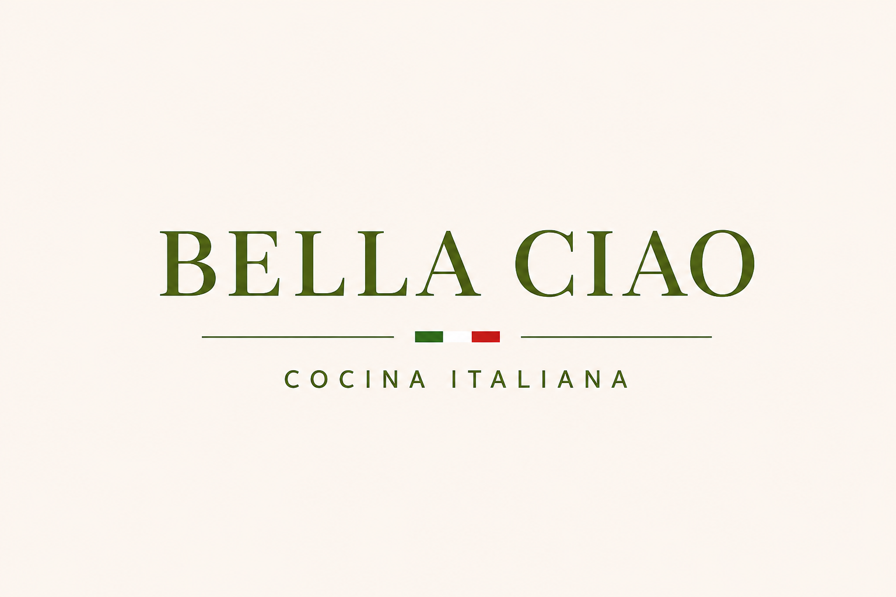
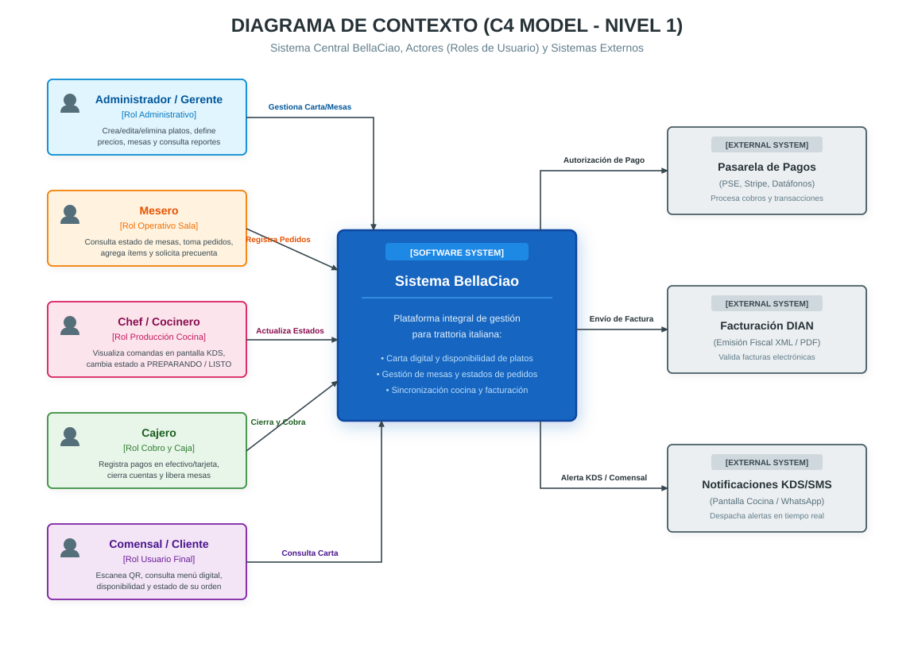
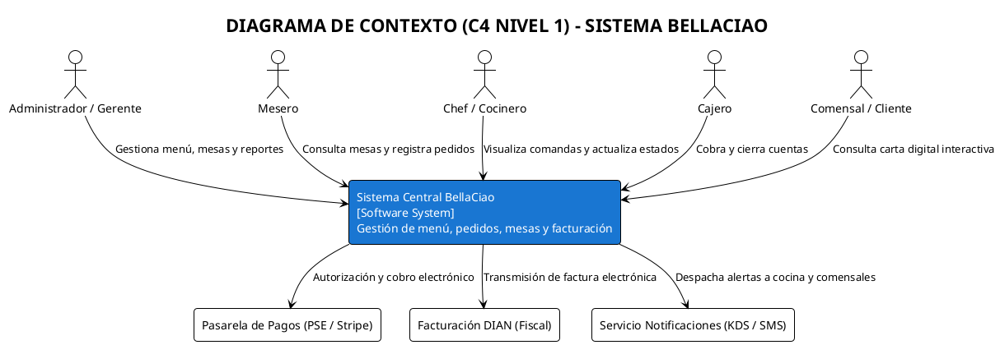
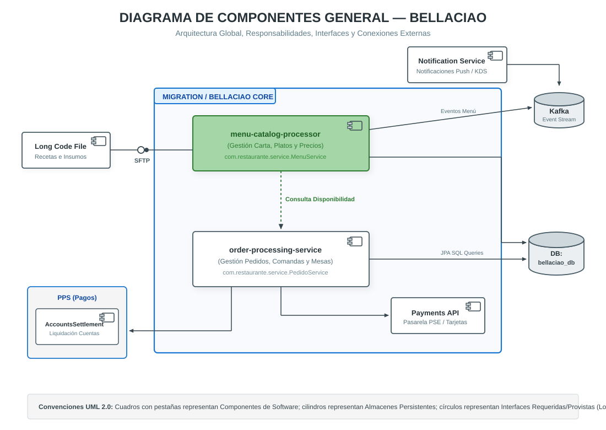
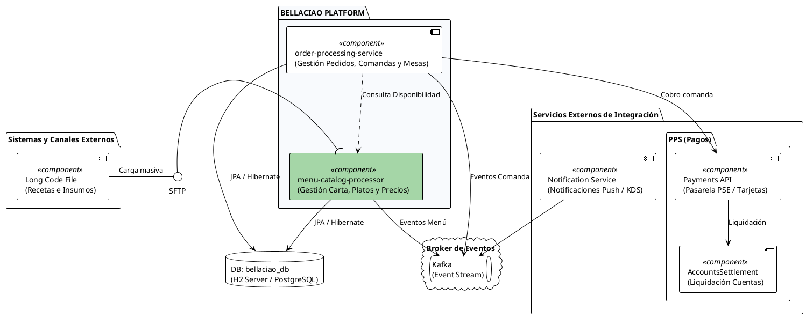
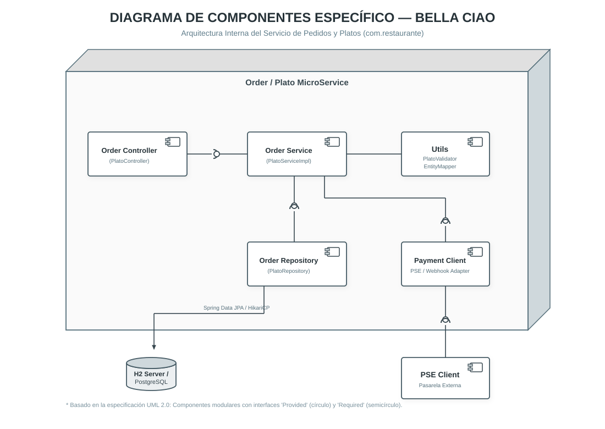
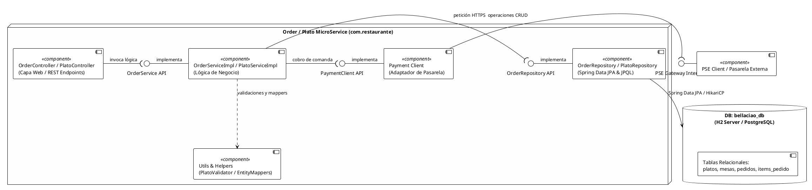

  <strong>Tradición clásica.</strong> 
  <em>Experiencia moderna.</em>

**BellaCiao** es una auténtica *trattoria italiana* que combina la tradición culinaria clásica con la eficiencia de un sistema de gestión moderno.

El restaurante se especializa en **pizzas al horno de leña** y **pastas artesanales**, preparadas con ingredientes de primera calidad. El sistema permite a los clientes **personalizar sus platos** bajo estrictos estándares gastronómicos, garantizando una experiencia consistente y de alta calidad.

Además, la plataforma permite optimizar procesos internos como:

- 📦 **Control de inventario**
- 🧾 **Facturación**
- 👨‍🍳 **Flujo de preparación en cocina**
- 🍕 **Personalización de platos**
- 📊 **Gestión de pedidos**

### 🎯 Objetivo

Desarrollar una solución de gestión para BellaCiao que permita optimizar
el manejo de pedidos, inventario, facturación y preparación en cocina,
manteniendo una experiencia de usuario sencilla y eficiente.
## Diagramas de Arquitectura

---

### 1. Diagrama de Contexto (C4 Model - Nivel 1)

> **Propósito:** Delimita el alcance del **Sistema BellaCiao**, mostrando a los usuarios/actores (roles del restaurante) que interactúan directamente con la aplicación y los sistemas externos de integración.

<b>Ver código PlantUML (.puml)</b>

Archivo fuente: [diagrama_contexto.puml](docs/diagrams/diagrama_contexto.puml)

---

### 👥 Matriz de Roles y Funcionalidades (Permisos del Restaurante)

> Archivo descargable para Excel: [roles_permisos_bellaciao.csv](docs/roles_permisos_bellaciao.csv)

| Rol | ¿Qué funcionalidades PUEDE hacer? | ¿Qué funcionalidades NO PUEDE hacer? |
| :--- | :--- | :--- |
| **Administrador / Gerente** | • Crear, modificar y eliminar platos de la carta. • Activar/desactivar disponibilidad de platos (`disponible: true/false`). • Fijar precios, categorías y recetas. • Crear y configurar mesas del salón. • Consultar reportes consolidados de ventas y auditoría. • Administrar usuarios y roles. | • Modificar o anular comandas ya cobradas y facturadas ante la DIAN. • Eliminar pistas de auditoría fiscal. |
| **Mesero** | • Consultar carta activa y disponibilidad en tiempo real. • Ver estado de ocupación de las mesas asignadas. • Crear nuevos pedidos asociados a una mesa (`POST /api/v1/pedidos`). • Adicionar ítems/platos a pedidos abiertos. • Solicitar precuenta para el cliente. | • Crear, editar o eliminar platos de la carta. • Modificar los precios de los platos. • Marcar platos como listos en cocina. • Cobrar o emitir facturas fiscales. • Cancelar pedidos en preparación sin autorización. |
| **Chef / Cocina** | • Visualizar comandas en pantalla KDS en tiempo real. • Cambiar el estado del pedido: `RECIBIDO` &rarr; `EN_PREPARACION` &rarr; `LISTO`. • Notificar a sala cuando los platos están listos para entrega. • Notificar agotamiento de insumos al administrador. | • Tomar pedidos o asignar mesas a clientes. • Modificar precios o registrar cobros. • Cancelar o eliminar pedidos de comensales. • Modificar la carta gastronómica. |
| **Cajero** | • Consultar el detalle de la cuenta de cualquier mesa con pedido abierto. • Registrar medios de pago (efectivo, datáfono, pasarela PSE). • Aplicar descuentos comerciales o propinas autorizadas. • Emitir factura de venta legal ante la DIAN. • Cerrar pedido y marcar la mesa como libre. | • Modificar platos, recetas o precios de la carta. • Cambiar el estado de preparación de los platos en cocina. • Alterar consumos sin autorización del administrador. |
| **Comensal / Cliente** | • Escanear código QR de la mesa y abrir el menú digital. • Consultar platos, fotos, descripciones, alérgenos y precios. • Filtrar por platos disponibles en tiempo real. • Consultar el estado de avance de su pedido. | • Crear, modificar o eliminar platos de la carta. • Cambiar estados de preparación culinaria. • Ver cuentas o pedidos de otras mesas. • Modificar pedidos ya confirmados en cocina sin el mesero. |

---

### 💾 Elección de Persistencia: ¿Por qué Relacional (SQL)?

Para **BellaCiao**, tras evaluar los tres modelos de persistencia, se determinó que la arquitectura **Relacional (RDBMS con Spring Data JPA + H2 / PostgreSQL)** es la solución óptima por las siguientes razones de ingeniería:

1. **Garantías ACID y Consistencia Financiera:** En un restaurante, los cobros, facturación y comandas exigen transaccionalidad estricta. Una cuenta no puede cobrarse a medias, ni una mesa puede figurar libre y ocupada a la vez.
2. **Integridad Referencial Estricta:** El modelo posee relaciones directas y de cardinalidad estricta (`Mesa` 1:N `Pedido` 1:N `ItemPedido` N:1 `Plato`). Las restricciones de clave foránea (`Foreign Key`) y borrado en cascada evitan inconsistencias históricas o comandas huérfanas.
3. **Cumplimiento Tributario (DIAN):** La facturación fiscal exige estructuras normalizadas, auditoría contable y esquemas relacionales inmutables.

---

## Diagramas de Arquitectura (Componentes UML)

---

### 2. Diagrama de Componentes General (Arquitectura Global del Sistema)

> **Propósito:** Muestra la arquitectura global de **BellaCiao**, cómo se conectan los módulos centrales con los sistemas externos, las responsabilidades de cada componente y los límites de dominio.

#### 📋 Especificación de Responsabilidades y Conexiones Externas
- **Límite de Dominio (`BELLACIAO PLATFORM / MIGRATION`):** Agrupa los componentes de negocio centrales desarrollados en Spring Boot:
  - `menu-catalog-processor` (`MenuService` / `PlatoService`): Administra la carta, platos, precios y disponibilidad en tiempo real.
  - `order-processing-service` (`PedidoService`): Gestiona la recepción de comandas, cálculo de subtotales, ítems de pedido y sincronización con mesas.
- **Dependencias y Sistemas Externos:**
  - **`Long Code File` (Insumos / Recetas):** Fuente de entrada para sincronización de insumos y carta vía canal SFTP.
  - **`Notification Service` & `Kafka`:** Cola de mensajería asíncrona para propagar eventos de preparación a la pantalla de cocina (KDS) y avisos a comensales.
  - **`DB: bellaciao_db`:** Base de datos relacional (PostgreSQL / H2 Server) accedida mediante Spring Data JPA e Hibernate con pool de conexiones HikariCP.
  - **`PPS (Pagos)` & `Payments API`:** Dominio externo para tokenización y cobro electrónico (PSE, tarjetas de crédito) y su posterior conciliación en `AccountsSettlement`.

<b>Ver código PlantUML (.puml)</b>

Archivo fuente: [diagrama_componentes_general.puml](docs/diagrams/diagrama_componentes_general.puml)

---

### 3. Diagrama de Componentes Específico (Arquitectura Interna del Servicio)

> **Propósito:** Muestra la arquitectura interna dentro del aplicativo (`Order / Plato MicroService`), detallando la organización de sus capas, la interfaz provista/requerida (*lollipop / socket*), componentes de soporte y dependencias de persistencia y pasarela.

#### 🧩 Identificación de Componentes Internos
1. **Controladores Web (`Order / Plato Controller`):**
   - Paquete: `com.restaurante.controller` (`PlatoController`, `PedidoController`, `MenuController`).
   - Expone la interfaz REST (`/api/v1/platos`, `/api/v1/pedidos`) y gestiona los DTOs de entrada/salida.
2. **Servicio o Lógica de Negocio (`Order / Plato Service`):**
   - Paquete: `com.restaurante.service.impl` (`PlatoServiceImpl`, `PedidoServiceImpl`).
   - Implementa la interfaz `OrderService API` / `PlatoService`. Encapsula las reglas de negocio, transacciones (`@Transactional`) y cálculo de totales.
3. **Módulos de Validación y Utilidades (`Utils`):**
   - `PlatoValidator`: Encapsula la validación de unicidad de platos directamente en base de datos (`existsByNombreIgnoreCase`).
   - `EntityMapper` & `DTOMapper`: Desacoplan el modelo de dominio puro (`Plato`, `Pedido`) de las entidades de persistencia JPA (`PlatoEntity`, `PedidoEntity`).
4. **Repositorio de Acceso a Datos (`Order / Plato Repository`):**
   - Paquete: `com.restaurante.persistence.repository` (`PlatoRepository`, `PedidoRepository`).
   - Spring Data JPA, consultas JPQL (`@Query`) y `@EntityGraph` para resolver eficientemente el problema de carga 1+N.
5. **Adaptador de Integración Externa (`Payment Client`):**
   - Conector interno que traduce y desacopla las peticiones del servicio de negocio hacia la API externa `PSE Client`.
6. **Almacenamiento Persistente (`DB: bellaciao_db`):**
   - Motor relacional H2 Server (puerto `9092`) / PostgreSQL con las tablas `plato`, `pedido`, `item_pedido`, `mesa`.

<b>Ver código PlantUML (.puml)</b>

Archivo fuente: [diagrama_componentes_especifico.puml](docs/diagrams/diagrama_componentes_especifico.puml)

---

### Autor

**Oscar Lasso**  
*Desarrollo y Operación de Software — DOSW 01*